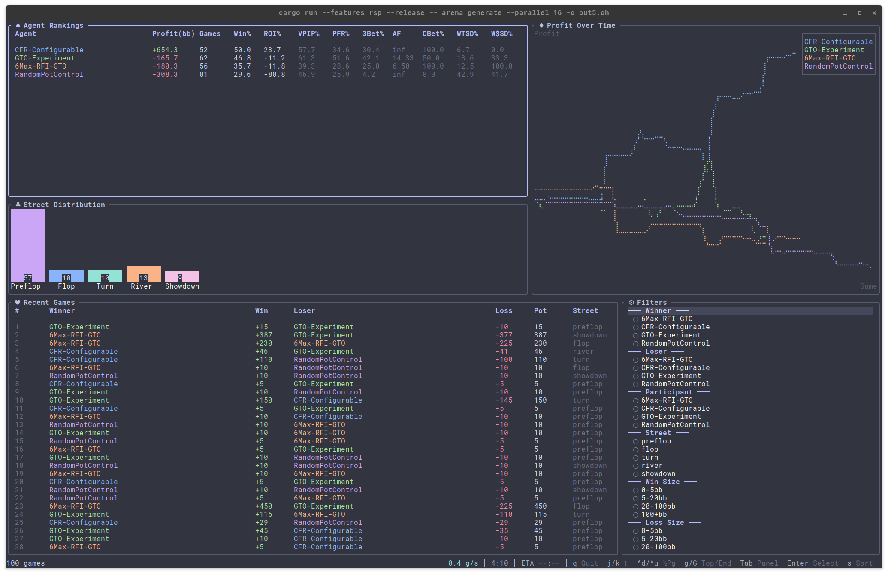

# LeChiffre

**LeChiffre** est un projet Rust de recherche et d'expérimentation autour du poker : simulation de mains, comparaison d'agents et modélisation du comportement de joueurs à partir d'historiques de parties.

Le projet s'appuie sur une copie locale de [`rs-poker`](vendor/rs-poker/README.md) pour les règles et les simulations de jeu. Il ajoute ses propres adaptateurs, son pipeline de données et un **Behavioral Engine hiérarchique Z₀/Z₁/Z₂**.

> **État actuel :** la CLI LeChiffre permet notamment une simulation *Random vs Random* et le traitement de données comportementales. L'Arena est fournie par `rs-poker` et compare des agents configurés en JSON. Cela ne constitue pas encore un agent LeChiffre entraîné capable de jouer de manière autonome dans l'Arena.

## Démarrage rapide

Prérequis : **Git, Make, Docker Engine et Docker Compose V2**. Rust et Cargo sont installés et utilisés **dans les images Docker**, pas sur la machine hôte.

Depuis la racine du dépôt :

```sh
# Voir les commandes disponibles (ne requiert pas Docker).
make help

# Construire les binaires dans Docker.
make build

# Simuler une main Random vs Random avec LeChiffre.
make app

# Vérifier le chargement des configurations des agents.
make poker ARGS="arena verify /workspace/agents"

# Lancer une comparaison dans l'Arena (terminal interactif).
make arena HANDS=100 PLAYERS=2
```

Sur une machine où l'accès au daemon Docker demande `sudo`, **le préciser explicitement** pour chaque commande Docker, sans modifier les droits de l'utilisateur :

```sh
make build COMPOSE="sudo docker compose"
make app COMPOSE="sudo docker compose"
make arena HANDS=100 PLAYERS=2 COMPOSE="sudo docker compose"
```

Le `Makefile` ne déclenche ni `sudo` ni script d'installation automatiquement. L'Arena peut consommer beaucoup de mémoire, particulièrement avec les agents CFR : ajuster la configuration des agents et la charge de simulation en fonction des ressources disponibles.

### Commandes principales

| Commande | Fonction |
| --- | --- |
| `make help` | Afficher les cibles du Makefile |
| `make build` | Construire les binaires LeChiffre et `rsp` |
| `make app` | Exécuter la simulation Random vs Random |
| `make arena HANDS=100 PLAYERS=2` | Comparer les agents JSON de `agents/` |
| `make poker ARGS="..."` | Exécuter une sous-commande du CLI `rsp` |
| `make behavioural ARGS="..." RUN_OPTIONS="..."` | Exécuter une commande comportementale avec les options Docker fournies |
| `make test` | Compiler l'environnement de test et lancer les contrôles Rust |
| `make smoke` | Tester le lancement des deux binaires |
| `make ci` | Exécuter les tests et les smoke tests |

Pour utiliser `sudo` avec ces cibles, ajouter `COMPOSE="sudo docker compose"` à la commande concernée. Voir [DOCKER.md](DOCKER.md) pour le détail des services, des permissions et des montages de données.

## Arena et moteur de poker

Le binaire **`rsp`**, issu de `vendor/rs-poker`, fournit notamment l'évaluation de mains, les simulations d'équité, les outils Hold'em et Omaha, et l'Arena multi-agents.

Les configurations actuellement présentes dans [`agents/`](agents/) sont : **Calling**, **Folding**, **Random**, **Equity**, **CFR Basic** et **CFR Simple**.

Pour consulter l'aide des commandes Arena :

```sh
make poker ARGS="arena --help"
make poker ARGS="arena compare --help"
```

Une comparaison non interactive, sans tableau de bord TUI :

```sh
docker compose run --rm -T poker \
  arena compare /workspace/agents -n 100 -p 2 --no-tui
```

Le mode interactif de l'Arena peut afficher un tableau de bord dans le terminal. Les sous-commandes du moteur incluent également la génération d'historiques et les comparaisons avec des paramètres de rake.



Documentation détaillée du moteur : [README de rs-poker](vendor/rs-poker/README.md) et [gestion des jetons, rake, historiques et replay](vendor/rs-poker/docs/MONEY_AND_HISTORY.md).

## Behavioral Engine Z₀ / Z₁ / Z₂

LeChiffre comprend un modèle comportemental hiérarchique utilisant un **Generator G** et un **Analyzer A**, dans un même espace latent :

- **Z₀ — blueprint global :** représentation de référence apprise à partir de mains historiques.
- **Z₁ — baseline individuelle :** adaptation au comportement observé d'un joueur, initialisée à Z₀.
- **Z₂ — état momentané :** représentation inférée pour une décision particulière, avec une distinction entre prédiction *avant* l'action et reconstruction *après* l'action.

Le pipeline disponible dans le binaire `lechiffre` couvre l'import CSV/JSON pris en charge, l'export Parquet, l'entraînement hiérarchique, l'évaluation, la reprise de checkpoints et la persistance des baselines individuelles.

Les fichiers `configs/hierarchical.example.json` et `configs/hierarchical-resume.example.json` sont **des exemples de structure**, pas des configurations universelles prêtes à entraîner un modèle sur n'importe quel dataset.

Les datasets privés et les sorties ne sont **pas montés automatiquement**. Pour une commande qui lit ou écrit des données, fournir explicitement les chemins et montages Docker vers des répertoires existants. Le projet ne crée aucun dossier hôte par anticipation.

Voir [docs/BEHAVIOURAL_ENGINE.md](docs/BEHAVIOURAL_ENGINE.md) pour l'architecture exacte du modèle, les commandes d'entraînement, les conditions de légalité des actions, les checkpoints et les limites de validation, puis [DOCKER.md](DOCKER.md) pour exécuter ces commandes dans des conteneurs.

## Organisation du dépôt

| Chemin | Rôle |
| --- | --- |
| `src/main.rs` | CLI de LeChiffre et simulation de démonstration |
| `src/adapters/` | Adaptateurs de sources et interface avec `rs-poker` |
| `src/behavioural/` | Modèle et états comportementaux |
| `src/datasets/` | Import, Parquet, chargement et entraînement |
| `vendor/rs-poker/` | Moteur de poker Rust et CLI `rsp` |
| `agents/` | Configurations JSON des agents de l'Arena |
| `configs/` | Exemples de configuration du Behavioral Engine |
| `Dockerfile`, `compose.yaml`, `Makefile` | Compilation et exécution conteneurisées |
| `docs/` | Documentation spécifique à LeChiffre |

Les crates expérimentales `crates/lechiffre-sdcfr/` et `crates/lechiffre-nlhe/` existent dans le dépôt, mais sont **exclues du périmètre Docker** actuel.

## Tests et portée de la CI

```sh
make ci
# Si le daemon Docker nécessite sudo :
make ci COMPOSE="sudo docker compose"
```

La CI compile les images, contrôle le formatage et Clippy, lance les tests Rust de LeChiffre et de `rs-poker`, puis exécute des smoke tests des deux binaires.

**Une CI verte ne valide pas à elle seule** une comparaison complète d'agents CFR en Arena, ni la qualité prédictive de Z₀/Z₁/Z₂ sur des historiques réels. Ces expériences nécessitent des validations dédiées.

## Documentation

- [DOCKER.md](DOCKER.md) — installation, commandes Docker et gestion explicite des fichiers de données.
- [docs/BEHAVIOURAL_ENGINE.md](docs/BEHAVIOURAL_ENGINE.md) — spécification et fonctionnement du modèle hiérarchique.
- [vendor/rs-poker/README.md](vendor/rs-poker/README.md) — utilisation du moteur, des agents et de l'Arena.
- [vendor/rs-poker/docs/MONEY_AND_HISTORY.md](vendor/rs-poker/docs/MONEY_AND_HISTORY.md) — unités monétaires, rake, formats d'historiques et validation du replay.

Les commandes Docker par défaut ne génèrent pas de `.env`, ne préparent pas de dossiers applicatifs sur l'hôte et ne modifient pas la configuration Git. Les sorties de commandes explicitement demandées restent soumises aux chemins et montages choisis par l'utilisateur.
